# Class Activity 1 — System Calls in Practice

- **Student Name:** Thy Rathanak
- **Student ID:** e20230271
- **Date:** [Date of Submission]

---

## Warm-Up: Hello System Call

Screenshot of running `hello_syscall.c` on Linux:

Screenshot of running `hello_winapi.c` on Windows (CMD/PowerShell/VS Code):

Screenshot of running `copyfilesyscall.c` on Linux:

---

## Task 1: File Creator & Reader

### Part A — File Creator

**Describe your implementation:** [What differences did you notice between the library version and the system call version?]

**Version A — Library Functions (`file_creator_lib.c`):**

<!-- Screenshot: gcc -o file_creator_lib file_creator_lib.c && ./file_creator_lib && cat output.txt -->

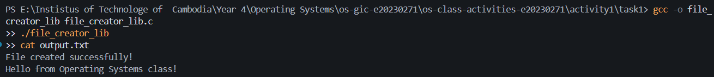

**Version B — POSIX System Calls (`file_creator_sys.c`):**

<!-- Screenshot: gcc -o file_creator_sys file_creator_sys.c && ./file_creator_sys && cat output.txt -->

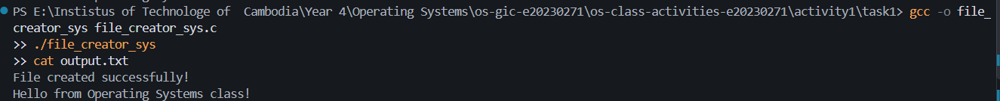

**Questions:**

1. **What flags did you pass to `open()`? What does each flag mean?**

I used O_WRONLY | O_CREAT | O_TRUNC.
O_WRONLY: Opens the file for writing only.
O_CREAT: Creates the file if it does not exist.
O_TRUNC: Clears the existing contents if the file already exists.
|: Combines the flags so they can be used together.

2. **What is `0644`? What does each digit represent?**

0644 specifies the file permissions when a new file is created, subject to the process's umask.
0: Indicates octal notation.
6: The owner can read and write (rw-).
4: The group can read (r--).
4: Other users can read (r--).

Therefore, the permissions are rw-r--r--.

3. **What does `fopen("output.txt", "w")` do internally that you had to do manually?**

fopen() opens the file for writing, creates it if it does not exist, and truncates it if it already exists. In the system-call version, I must explicitly use open() with O_WRONLY | O_CREAT | O_TRUNC. The library version also creates a FILE stream and manages buffering.

### Part B — File Reader & Display

**Describe your implementation:** [Your notes]

**Version A — Library Functions (`file_reader_lib.c`):**

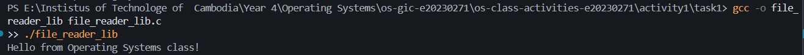

**Version B — POSIX System Calls (`file_reader_sys.c`):**

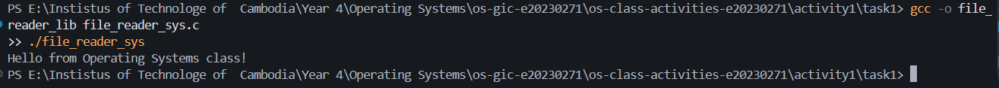

**Questions:**

1. **What does `read()` return? How is this different from `fgets()`?**

  `read()` returns the number of bytes actually read. It returns 0 at the end of the file and -1 if an error occurs. fgets() returns a pointer to the buffer when it successfully reads a line or part of a line, and returns NULL when it reaches the end of the file without reading more data or when an error occurs.

2. **Why do you need a loop when using `read()`? When does it stop?**

  A loop is needed because one call to `read()` may not read the entire file. The loop continues reading and displaying data until `read()` returns 0, indicating the end of the file. If read() returns -1, an error has occurred.

---

## Task 2: Directory Listing & File Info

**Describe your implementation:** [Your notes]

### Version A — Library Functions (`dir_list_lib.c`)

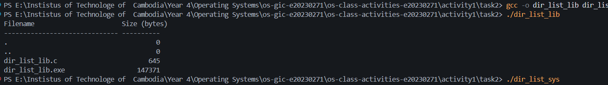

### Version B — System Calls (`dir_list_sys.c`)

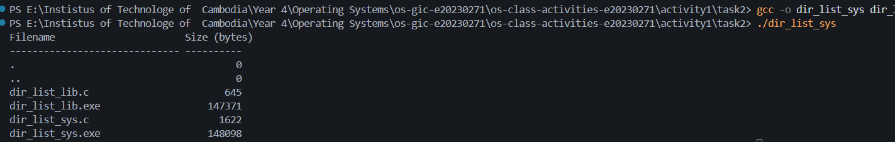

### Questions

1. **What struct does `readdir()` return? What fields does it contain?**

readdir() returns a pointer to a struct dirent, which describes one directory entry. Important fields include:
d_name: The name of the file or directory.
d_ino: The inode number.
d_type: The entry type on systems that provide it, such as a regular file or directory. Its availability and meaning depend on the filesystem.
readdir() returns NULL when there are no more entries or when an error occurs.

2. **What information does `stat()` provide beyond file size?**

stat() provides several details about a file, including its file type, permissions, inode number, owner ID, group ID, number of hard links, file size, and timestamps such as the last modification time and last access time.

3. **Why can't you `write()` a number directly — why do you need `snprintf()` first?**

write() writes bytes from a memory buffer. An integer is stored in binary form in memory, not as the decimal characters that people normally read. Therefore, snprintf() converts the filename and file size into formatted text in a character buffer. Then write() can output those characters to the terminal.

---

## Optional Bonus: Windows API (`file_creator_win.c`)

Screenshot of running on Windows:

### Bonus Questions

1. **Why does Windows use `HANDLE` instead of integer file descriptors?**

   > [Your answer]

2. **What is the Windows equivalent of POSIX `fork()`? Why is it different?**

   > [Your answer]

3. **Can you use POSIX calls on Windows?**

   > [Your answer]

---

## Task 3: strace Analysis

**Describe what you observed:** [What surprised you about the strace output? How many more system calls did the library version make?]

### strace Output — Library Version (File Creator)

<!-- Screenshot: strace -e trace=openat,read,write,close ./file_creator_lib -->
<!-- IMPORTANT: Highlight/annotate the key system calls in your screenshot -->

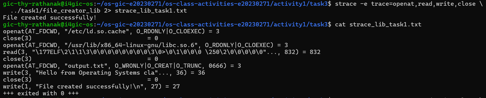

### strace Output — System Call Version (File Creator)

<!-- Screenshot: strace -e trace=openat,read,write,close ./file_creator_sys -->
<!-- IMPORTANT: Highlight/annotate the key system calls in your screenshot -->

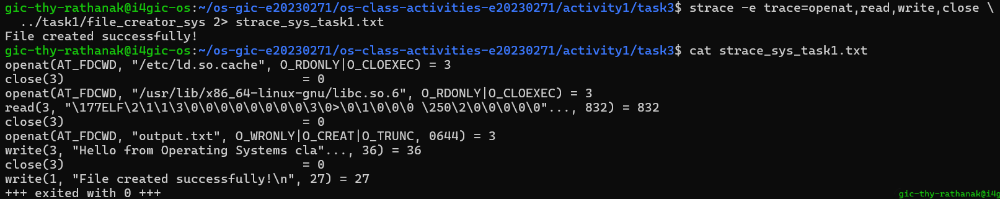

### strace Output — Library Version (File Reader or Dir Listing)

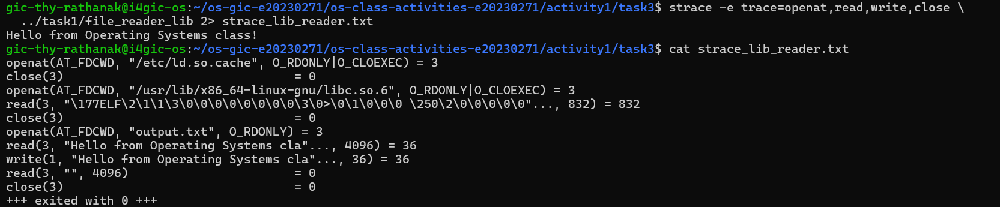

### strace Output — System Call Version (File Reader or Dir Listing)

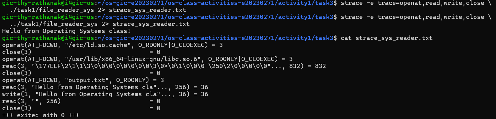

### strace -c Summary Comparison

<!-- Screenshot of `strace -c` output for both versions -->

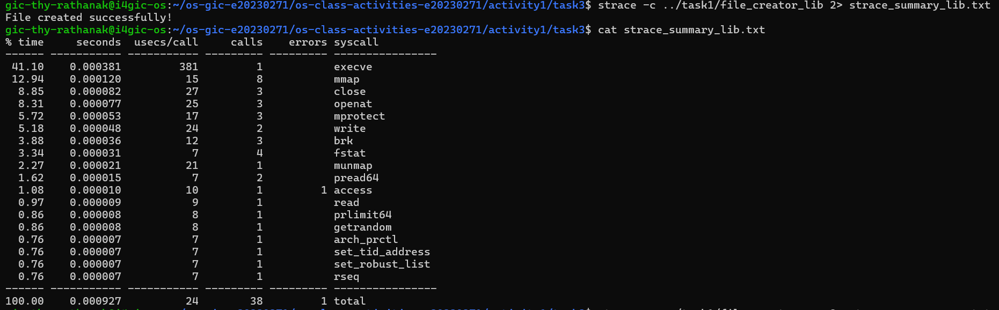
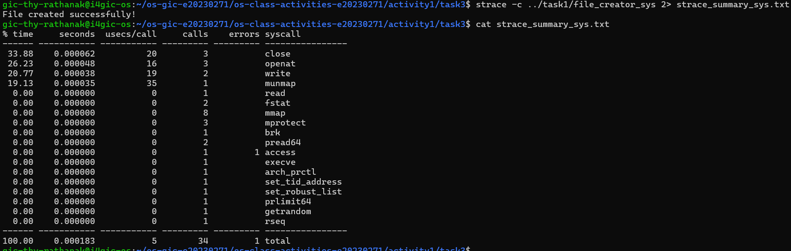

### Questions

1. **How many system calls does the library version make compared to the system call version?**

   > [Your answer — use the `strace -c` counts]

2. **What extra system calls appear in the library version? What do they do?**

   > [Your answer — mention `brk`, `mmap`, `fstat`, etc.]

3. **How many `write()` calls does `fprintf()` actually produce?**

   > [Your answer]

4. **In your own words, what is the real difference between a library function and a system call?**

   > [Your answer]

---

## Task 4: Exploring OS Structure

### System Information

> 📸 Screenshot of `uname -a`, `/proc/cpuinfo`, `/proc/meminfo`, `/proc/version`, `/proc/uptime`:

### Process Information

> 📸 Screenshot of `/proc/self/status`, `/proc/self/maps`, `ps aux`:

### Kernel Modules

> 📸 Screenshot of `lsmod` and `modinfo`:

### OS Layers Diagram

> 📸 Your diagram of the OS layers, labeled with real data from your system:

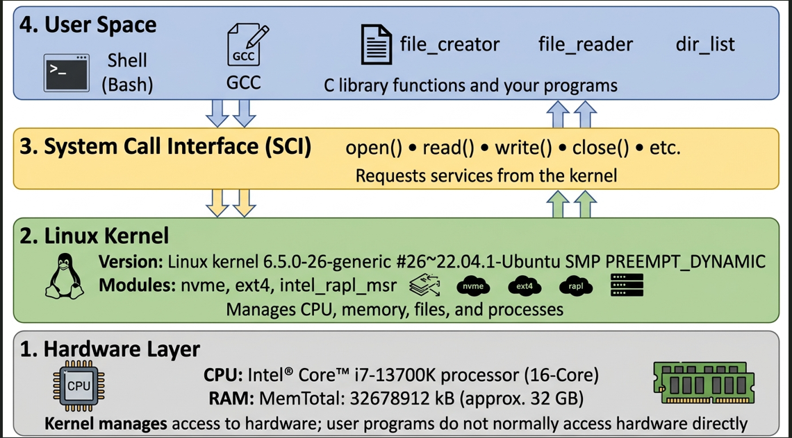

### Questions

1. **What is `/proc`? Is it a real filesystem on disk?**

   > [Your answer]

2. **Monolithic kernel vs. microkernel — which type does Linux use?**

   > [Your answer]

3. **What memory regions do you see in `/proc/self/maps`?**

   > [Your answer]

4. **Break down the kernel version string from `uname -a`.**

   > [Your answer]

5. **How does `/proc` show that the OS is an intermediary between programs and hardware?**

   > [Your answer]

---

## Reflection

What did you learn from this activity? What was the most surprising difference between library functions and system calls?

> [Write your reflection here]
