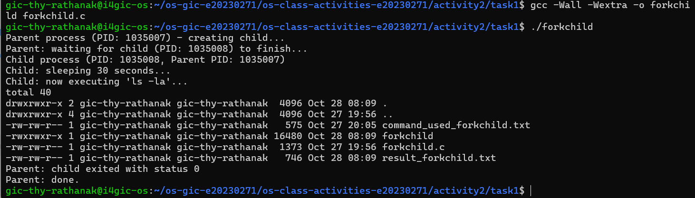
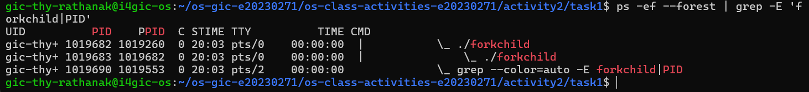
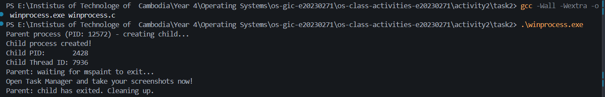
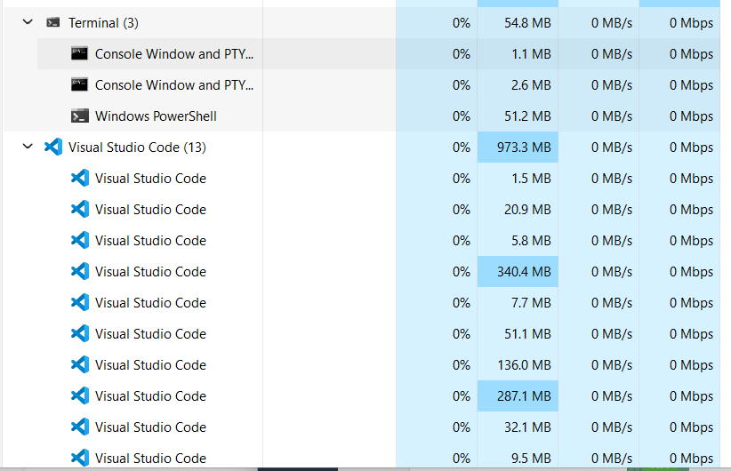
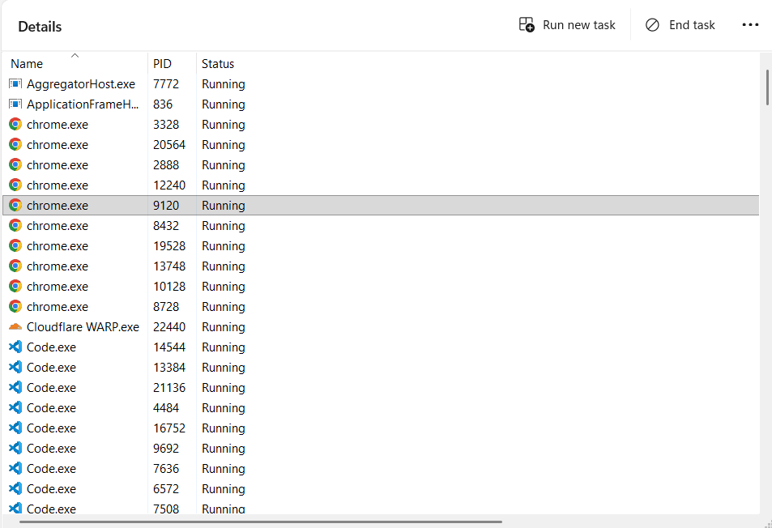
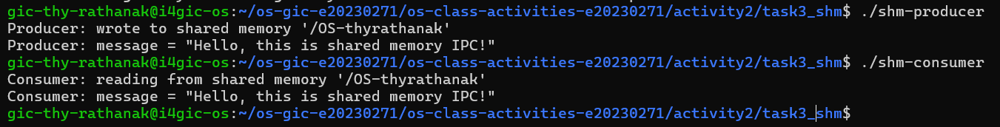
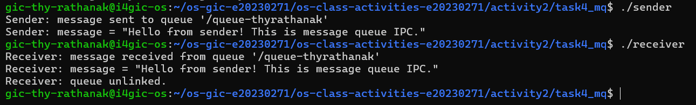

# Class Activity 2 — Processes & Inter-Process Communication

- **Student Name:** [Your Name Here]
- **Student ID:** [Your Student ID Here]
- **Date:** [Date of Submission]

---

## Task 1: Process Creation on Linux (fork + exec)

### Compilation & Execution

Screenshot of compiling and running `forkchild.c`:



### Process Tree

Screenshot of the parent-child process tree (using `ps --forest`, `pstree`, or `htop` tree view):



### Output

```
Parent process (PID: 1034969) - creating child...
Parent: waiting for child (PID: 1034970) to finish...
Child process (PID: 1034970, Parent PID: 1034969)
Child: sleeping 30 seconds...
Child: now executing 'ls -la'...
total 40
drwxrwxr-x 2 gic-thy-rathanak gic-thy-rathanak  4096 Oct 28 08:08 .
drwxrwxr-x 4 gic-thy-rathanak gic-thy-rathanak  4096 Oct 27 19:56 ..
-rw-rw-r-- 1 gic-thy-rathanak gic-thy-rathanak   575 Oct 27 20:05 command_used_forkchild.txt
-rwxrwxr-x 1 gic-thy-rathanak gic-thy-rathanak 16480 Oct 28 08:08 forkchild
-rw-rw-r-- 1 gic-thy-rathanak gic-thy-rathanak  1373 Oct 27 19:56 forkchild.c
-rw-rw-r-- 1 gic-thy-rathanak gic-thy-rathanak   217 Oct 28 08:09 result_forkchild.txt
Parent: child exited with status 0
Parent: done.
```

### Questions

1. **What does `fork()` return to the parent? What does it return to the child?**

fork() returns the child's PID to the parent, 0 to the child, and -1 if an error occurs.

2. **What happens if you remove the `waitpid()` call? Why might the output look different?**

The parent does not wait for the child to finish. The parent may print its final message before the child finishes, so the output order can change. The child may temporarily become a zombie if it finishes before the parent exits.]

3. **What does `execlp()` do? Why don't we see "execlp failed" when it succeeds?**

execlp() replaces the current process's program with another program, searching the PATH for the executable. When it succeeds, it does not return, so the error message is not printed.

4. **Draw the process tree for your program (parent → child). Include PIDs from your output.**

forkchild (Parent PID: REPLACE_WITH_PARENT_PID)
└── forkchild (Child PID: REPLACE_WITH_CHILD_PID)

5. **Which command did you use to view the process tree (`ps --forest`, `pstree`, or `htop`)? What information does each column show?**

I used ps -ef --forest | grep -E 'forkchild|PID'. The PID column shows each process ID, PPID shows its parent process ID, USER shows the process owner, and CMD shows the command. The forest view shows the parent-child hierarchy.

---

## Task 2: Process Creation on Windows

### Compilation & Execution

Screenshot of compiling and running `winprocess.c`:



### Task Manager Screenshots

Screenshot showing process tree in the **Processes** tab (mspaint nested under your program):



Screenshot showing PID and Parent PID in the **Details** tab:



### Questions

1. **What is the key difference between how Linux creates a process (`fork` + `exec`) and how Windows does it (`CreateProcess`)?**

Linux uses fork() to create a child process and exec() to replace its program. Windows uses CreateProcess() to create a process and load a program in one call.

2. **What does `WaitForSingleObject()` do? What is its Linux equivalent?**

WaitForSingleObject() waits for the specified process or object to reach a signaled state. Here, it waits for Paint to exit. Its closest Linux equivalent is waitpid().

3. **Why do we need to call `CloseHandle()` at the end? What happens if we don't?**

CloseHandle() releases the process and thread handles when they are no longer needed. If we do not close them, the program can leak handles and consume system resources.

4. **In Task Manager, what was the PID of your parent program and the PID of mspaint? Do they match your program's output?**

The PID of my parent program (winprocess.exe) was [enter your PID]. The PID of mspaint.exe was [enter Paint's PID]. The Parent PID of Paint in Task Manager was [enter Parent PID]. The relationship was [verified/not verified] because [explain whether the Parent PID matched the parent's PID].

5. **Compare the Processes tab (tree view) and the Details tab (PID/PPID columns). Which view makes it easier to understand the parent-child relationship? Why?**

The Processes tab is easier for understanding applications visually. The Details tab is more useful for verifying the exact parent-child relationship because it displays the PID and Parent PID values.

---

## Task 3: Shared Memory IPC

### Compilation & Execution

Screenshot of compiling and running `shm-producer` and `shm-consumer`:



### Output

```
[Paste the content of result-shm-ipc.txt here]
```

### Questions

1. **What does `shm_open()` do? How is it different from `open()`?**

   > [Your answer]

2. **What does `mmap()` do? Why is shared memory faster than other IPC methods?**

   > [Your answer]

3. **Why must the shared memory name match between producer and consumer?**

   > [Your answer]

4. **What does `shm_unlink()` do? What would happen if the consumer didn't call it?**

   > [Your answer]

5. **If the consumer runs before the producer, what happens? Try it and describe the error.**

   > [Your answer]

---

## Task 4: Message Queue IPC

### Compilation & Execution

Screenshot of compiling and running `sender` and `receiver`:



### Output

```
[Paste the content of result-mq-ipc.txt here]
```

### Questions

1. **How is a message queue different from shared memory? When would you use one over the other?**

   > [Your answer]

2. **Why does the queue name in `common.h` need to start with `/`?**

   > [Your answer]

3. **What does `mq_unlink()` do? What happens if neither the sender nor receiver calls it?**

   > [Your answer]

4. **What happens if you run the receiver before the sender?**

   > [Your answer]

5. **Can multiple senders send to the same queue? Can multiple receivers read from the same queue?**

   > [Your answer]

---

## Reflection

What did you learn from this activity? What was the most interesting difference between Linux and Windows process creation? Which IPC method do you prefer and why?

> [Write your reflection here]