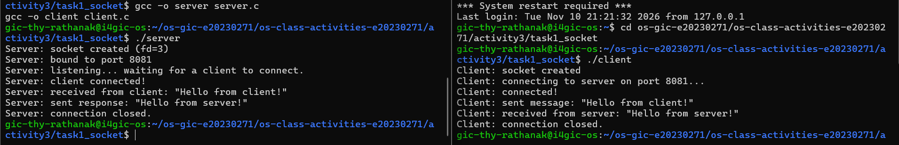
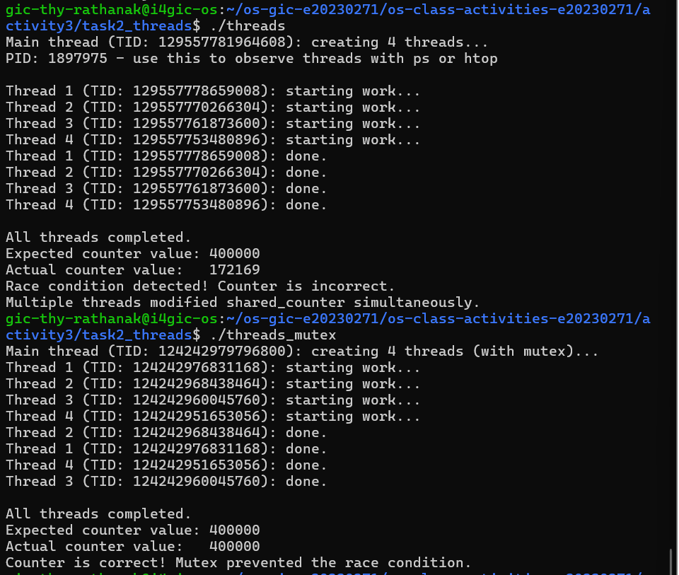
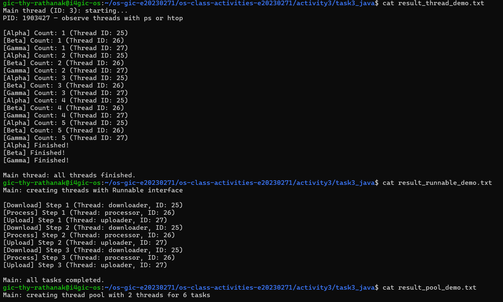
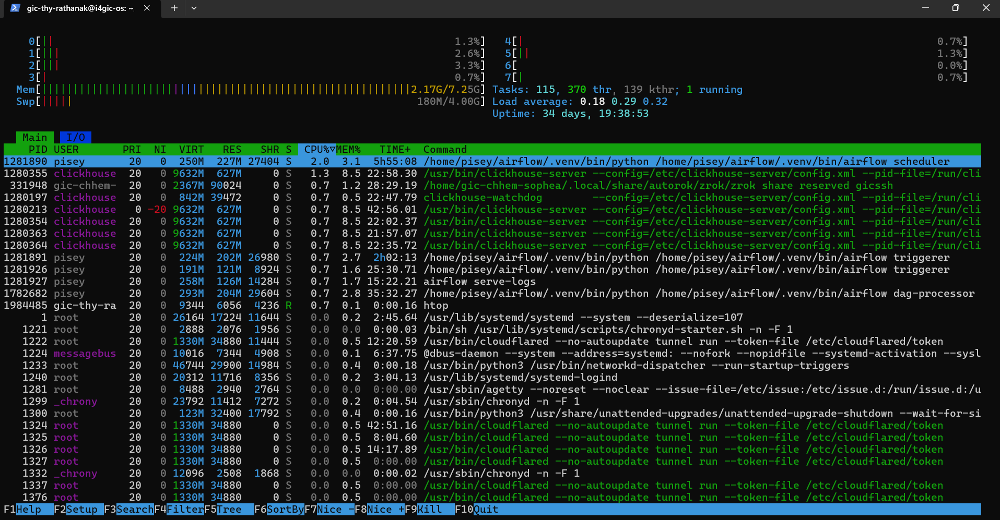
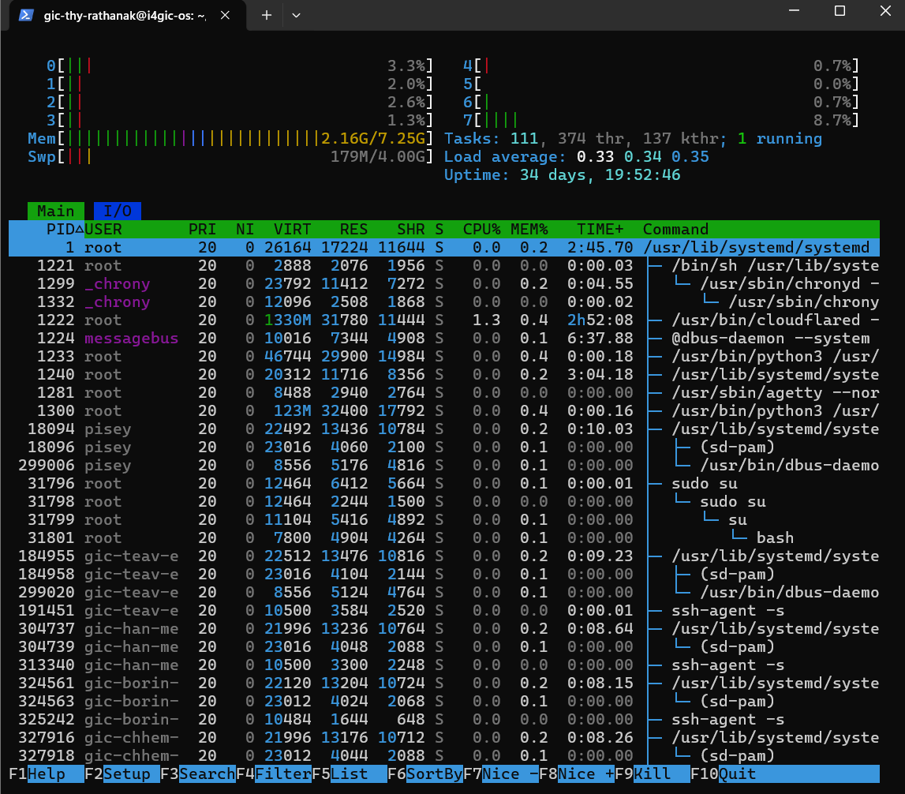
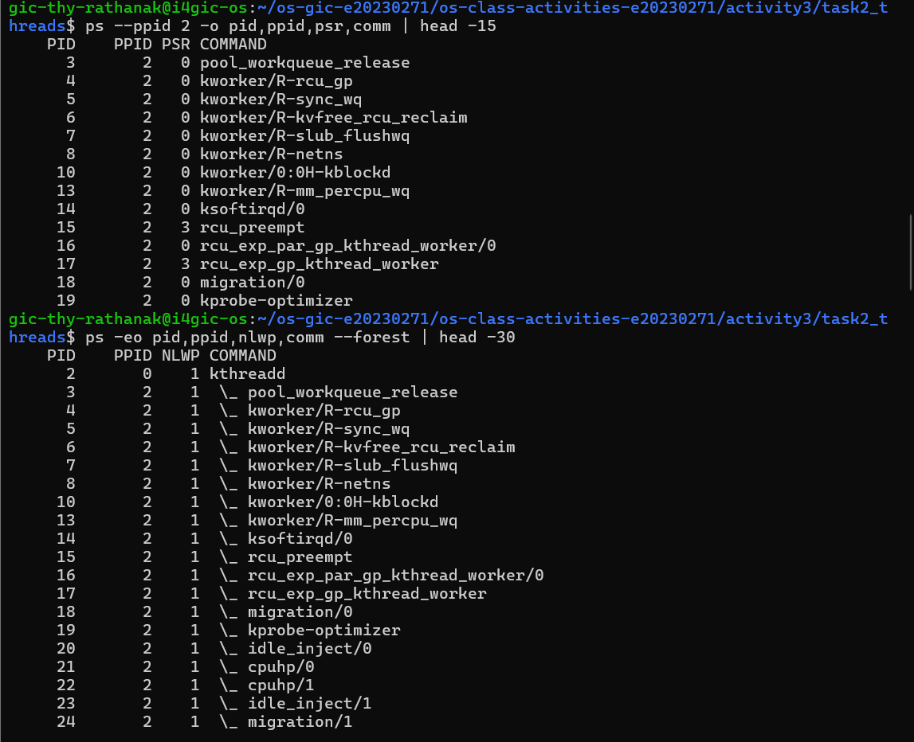
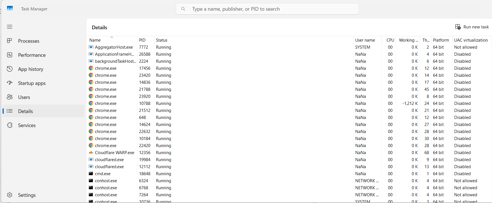

# Class Activity 3 — Socket Communication & Multithreading

- **Student Name:** Thy Rathanak
- **Student ID:** e20230271
- **Date:** 11/11/2026

---

## Task 1: TCP Socket Communication (C)

### Compilation & Execution

### Answers

1. **Role of `bind()` / Why client doesn't call it:**

bind() assigns a specific IP address and port number to the server socket. The client does not need to call bind() because the operating system automatically assigns an available local port when it connects to the server.

2. **What `accept()` returns:**

accept() returns a new socket file descriptor for communicating with the connected client. The original server socket continues listening for new connections, while the new socket handles communication with the client.

3. **Starting client before server:**

The client cannot connect because no server is listening on port 8080. It displays a connection error, usually:
connect: Connection refused

4. **What `htons()` does:**

htons() means Host To Network Short. It converts the port number from the computer's host byte order into network byte order (big-endian), ensuring that the port is represented correctly during network communication.

5. **Socket call sequence diagram:**
   SERVER CLIENT

---

socket() socket()
| |
bind() |
| |
listen() |
| connect()
accept() <------------------------|
| |
read() <----------------------- send()
| |
send() -----------------------> read()
| |
close() close()
|
close()

---

## Task 2: POSIX Threads (C)

### Output — Without Mutex (Race Condition)

### Output — With Mutex (Correct)

_(Include in the same screenshot or a separate one)_

### Answers

1. **What is a race condition?**

A race condition occurs when multiple threads access and modify shared data at the same time without proper synchronization. In threads.c, all four threads increment shared_counter simultaneously. Some increments may be lost because the operation is not atomic, resulting in an incorrect counter value

2. **What does `pthread_mutex_lock()` do?**

pthread_mutex_lock() locks a shared resource so that only one thread can access the protected section at a time. pthread_mutex_unlock() releases the lock. It prevents multiple threads from modifying shared_counter simultaneously and ensures the correct result.

3. **Removing `pthread_join()`:**

Without pthread_join(), the main thread does not wait for worker threads to finish. When the main thread returns from main(), the entire process terminates, including unfinished worker threads. Therefore, some threads may not complete their work.

4. **Thread vs Process:**
   A process is an independent program in execution, while a thread is a smaller unit of execution inside a process.

Threads in the same process share:

- Code
- Data and global variables
- Heap memory
- Open files
  Each thread has its own:
- Stack
- Registers
- Thread ID (TID)

---

## Task 3: Java Multithreading

### ThreadDemo Output

### RunnableDemo Output

_(Include output or screenshot)_

### PoolDemo Output

_(Include output or screenshot)_

### Answers

1. **Thread vs Runnable:**

Extending Thread means creating a new class that inherits from the Thread class and overrides its run() method.

Implementing Runnable means creating a class that implements the Runnable interface and defines its run() method. The Runnable object can then be passed to a Thread.

I prefer implementing Runnable because Java classes can implement multiple interfaces but can extend only one class. It also separates the task from the thread that executes it.

2. **Pool size limiting concurrency:**

Because Executors.newFixedThreadPool(2) creates a thread pool with only two worker threads. Only two tasks can execute at the same time. The other four tasks wait in the queue until a worker becomes available.

3. **thread.join() in Java:**

thread.join() makes the current thread wait until the specified thread finishes its execution.

In ThreadDemo, the main thread waits for all three worker threads to finish. If we remove join(), the main thread may print its completion message before the worker threads finish. However, the Java process normally continues while other non-daemon threads are still running.v

4. **ExecutorService advantages:**
   ExecutorService manages a pool of reusable worker threads. It reduces the overhead of repeatedly creating threads, controls the number of concurrent tasks, and provides methods to submit tasks and shut down the pool. This makes thread management easier and more efficient for large applications.

Files

ThreadDemo.java
result_thread_demo.txt
RunnableDemo.java
result_runnable_demo.txt
PoolDemo.java
result_pool_demo.txt
command_used_java.txt
task3_java_screenshot.png

---

## Task 4: Observing Threads

### Linux — `ps -eLf` Output

_(Paste the relevant ps output here)_

### Linux — htop Thread View

### Linux — htop Kernel Threads (tree view, `kthreadd`)

### Linux — Kernel Threads (commands)

_(Paste the output of `ps -L ...` and `ps --ppid 2 ...` here)_

### Windows — Task Manager

### Answers

1. **LWP column meaning:**

LWP stands for Light Weight Process. It represents the thread ID assigned by the Linux kernel. Each thread has its own LWP ID, while threads belonging to the same process share the same PID.

2. **/proc/PID/task/ count:**

I found 5 entries in /proc/<PID>/task/. This matches the number of threads in my program: one main thread and four worker threads.

3. **Extra Java threads:**

The Java process shows more than three threads because the JVM creates additional internal threads to manage its operations. These include garbage collection, background processing, compiler, and other JVM management threads.

4. **Linux vs Windows thread viewing:**

Linux provides detailed thread information using ps and /proc, including thread IDs, process IDs, thread counts, CPU cores, and thread states. Windows Task Manager provides a simpler overview, mainly showing the total number of threads for a process.

Linux provides more detailed information about individual threads.

5. **kthreadd and three kernel threads:**

kthreadd is the Linux kernel thread manager responsible for creating and managing other kernel threads. Its PID is 2.

Three examples of kernel threads are:

ksoftirqd/0

rcu_sched

kworker/...

They are kernel threads because they are children of kthreadd and do not belong to normal user applications.

[If WSL hides kernel threads, replace the paragraph above with: My WSL environment did not display the kernel threads. This is a limitation of the environment, not evidence that kernel threads do not exist.]

6. **TID equal to PID, NLWP and cores:**

The main thread has a thread ID equal to the process ID (PID). NLWP represents the total number of lightweight processes (threads) in the process. My program had 5 threads.

The threads ran on CPU cores: [write the PSR/PROCESSOR values you observed].

7. **`H` and `K` in htop:**
   H shows or hides user threads belonging to processes.

K shows or hides kernel threads.

## Without H, individual user threads may not be visible. Without K, kernel threads may be hidden from the process list.

## Reflection

> _What did you find most interesting about socket communication and threading? How does understanding threads at the OS level help you write better concurrent programs?_

### Reflection

What I found most interesting about socket communication and threading is how a program can communicate with another computer through a network while handling multiple tasks at the same time. Socket communication allows two programs to exchange data, while threading allows a program to perform multiple operations concurrently without waiting for each task to finish.

Understanding threads at the OS level helps me write better concurrent programs because I can understand how the operating system creates, schedules, and manages threads. I also learned that each thread has its own thread ID (LWP) but shares resources with other threads in the same process. This knowledge helps me manage shared data carefully, avoid race conditions, use synchronization when necessary, and understand the performance impact of creating too many threads.
