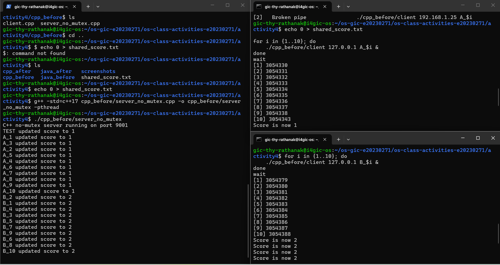
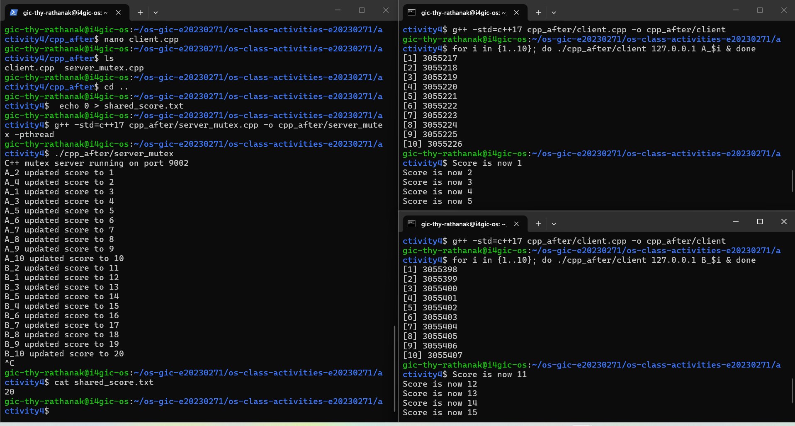
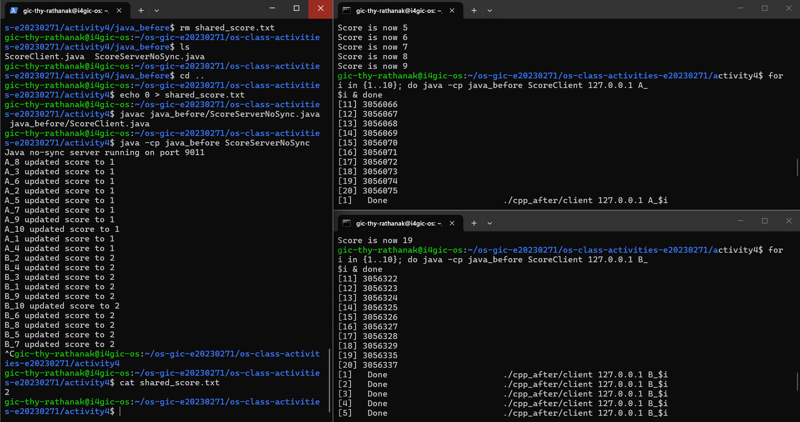
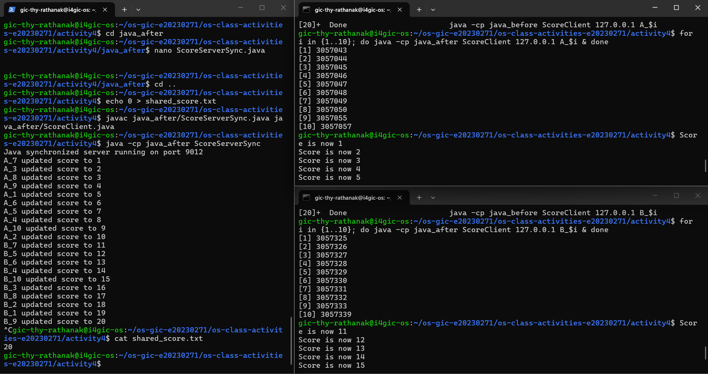

# Class Activity 4 — Shared File API

- **Student Name:** Thy Rathanak
- **Student ID:** e20230271
- **Partner Name:** Rathanak
- **Partner Student ID:** 127.0.0.1
- **Server Machine Owner:** Thy Rathanak
- **Server IP Address:** 127.0.0.1

---

## 1. Introduction

This activity demonstrates how to protect a shared file when multiple clients send requests to a server at the same time.

The server acts as an API that receives client requests and updates `shared_score.txt`.

We implemented four versions:

- C++ without mutex
- C++ with `std::mutex`
- Java without `synchronized`
- Java with `synchronized`

Each student sends 10 requests, making 20 requests in total.

**Expected final score: 20**

---

## 2. Task 1: C++ Before Mutex

**Port:** 9001

In this task, the C++ server handles each client in a separate thread without using a mutex.

When multiple clients update the file simultaneously, a race condition may occur because two threads can read the same score before either thread writes the updated value.



- **Expected score:** 20
- **Actual score:** 2
- **Observation:** Without synchronization, multiple threads may access and update the shared file at the same time. Some updates may be lost, resulting in a final score lower than 20.

---

## 3. Task 2: C++ After Mutex

**Port:** 9002

In this task, we added `std::mutex` and `std::lock_guard<std::mutex>` to protect the `update_score()` function.

The mutex ensures that only one thread can execute the file update operation at a time. Other threads must wait until the current thread releases the lock.



- **Expected score:** 20
- **Actual score:** 20
- **Observation:** After adding the mutex, file updates are performed one at a time. No updates are lost, and the final score should be 20.

---

## 4. Task 3: Java Before Synchronized

**Port:** 9011

In this task, the Java server creates a new thread for every client request without using `synchronized`.

Multiple threads can read and write `shared_score.txt` simultaneously, which can cause a race condition and lost updates.



- **Expected score:** 20
- **Actual score:** 2
- **Observation:** Without synchronization, multiple Java threads may access the shared file at the same time. As a result, some score updates may be lost.

---

## 5. Task 4: Java After Synchronized

**Port:** 9012

In this task, we added the `synchronized` keyword to the `updateScore()` method.

This ensures that only one thread at a time can execute this static synchronized method on the `ScoreServerSync` class.

Other threads must wait until the current thread finishes updating the file.



- **Expected score:** 20
- **Actual score:** 20
- **Observation:** After adding `synchronized`, only one thread can update the shared file at a time. Therefore, all 20 requests should be processed correctly.

---

## 6. Questions and Answers

### 1. Why should clients send requests to the server instead of writing the file directly?

Clients should send requests to the server because the server controls access to the shared file. This prevents many clients from directly modifying the same file and allows the server to manage updates in one central location.

### 2. Why does the server still have a race condition before mutex or `synchronized`?

The server creates a separate thread for each client. Multiple threads can execute the file update operation simultaneously. For example, two threads may read the same score, increase it, and write the same result. This causes lost updates.

### 3. In the C++ fixed version, what does `std::lock_guard<std::mutex>` protect?

`std::lock_guard<std::mutex>` protects the critical section inside `update_score()`. It automatically locks the mutex when created and unlocks it when the function scope ends. This ensures that only one thread can read, modify, and write the shared score at a time.

### 4. In the Java fixed version, what does `synchronized` protect?

The `synchronized` keyword protects the `updateScore()` method. Because it is a static synchronized method, Java uses the class-level lock. Only one thread can execute this method at a time for that class.

### 5. Why is the final score expected to be 20 when Student A sends 10 requests and Student B sends 10 requests?

The initial score is 0. Student A sends 10 requests, and Student B sends another 10 requests. Each successful request increases the score by 1.

Therefore:

- Initial score = 0
- Student A = 10 requests
- Student B = 10 requests
- Total requests = 20

Final score = 0 + 10 + 10 = **20**

### 6. What could happen if two separate servers update the same file at the same time?

A race condition could occur because each server has its own mutex or synchronization mechanism. These locks do not automatically coordinate with another server process. Both servers may read the same score and overwrite each other's updates, causing lost updates.

A shared database with transactions or an operating-system-level file lock could be used to coordinate access between separate server processes.

---

## 7. Comparison: C++ Mutex vs Java Synchronized

| Feature | C++ | Java |
|---|---|---|
| Synchronization | `std::mutex` | `synchronized` |
| Lock management | `std::lock_guard` | Automatic |
| Critical section | Protected by mutex | Protected by object/class monitor |
| Unlocking | Automatic with `lock_guard` | Automatic when leaving synchronized method |
| Purpose | Prevent race conditions | Prevent race conditions |

Both approaches ensure that only one thread at a time can execute the protected file update operation.

---

## 8. Reflection

Through this activity, I learned that using a server to manage a shared file does not automatically prevent race conditions. When a server handles multiple clients using separate threads, those threads can still access the same resource simultaneously.

In C++, `std::mutex` and `std::lock_guard` protect the critical section. In Java, the `synchronized` keyword provides similar protection.

After synchronization, the server can process concurrent client requests safely without losing score updates.

This activity helped me understand the importance of critical sections, mutual exclusion, and thread synchronization when multiple programs share the same resource.

---

## 9. Conclusion

This activity demonstrated the difference between synchronized and unsynchronized access to a shared file.

Without synchronization, concurrent requests may cause race conditions and lost updates. With C++ mutex and Java `synchronized`, the server can safely update the shared score.

The expected final score after 20 successful requests is **20**.

---

## 10. Project Structure

```text
activity4/
├── README.md
├── shared_score.txt
├── screenshots/
│   ├── cpp_before_mutex.png
│   ├── cpp_after_mutex.png
│   ├── java_before_synchronized.png
│   └── java_after_synchronized.png
├── cpp_before/
│   ├── server_no_mutex.cpp
│   └── client.cpp
├── cpp_after/
│   ├── server_mutex.cpp
│   └── client.cpp
├── java_before/
│   ├── ScoreServerNoSync.java
│   └── ScoreClient.java
└── java_after/
    ├── ScoreServerSync.java
    └── ScoreClient.java
```

